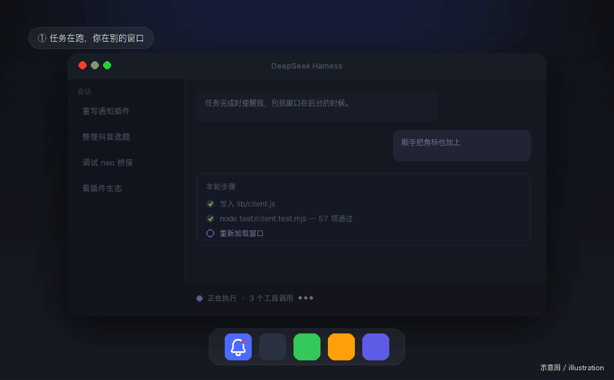

# dsh-plugin-desktop-notify

给 DSH 加**桌面通知 + 应用图标小红点**：任务完成、等待你操作、任务失败时提醒你，点通知直接回到那个会话。

[](https://www.npmjs.com/package/dsh-plugin-desktop-notify)
[](LICENSE)
[](https://github.com/chendaleiQ/dsh-plugin-desktop-notify)



*（真实录屏，只截取了通知区域）*

## 它做什么

- **任务完成**——包括窗口切到后台、你在别的应用里的时候
- **等待你操作**——工具审批、提问、执行计划确认
- **任务失败**——这一轮出错时提示
- **说清楚怎么结束的**——正常完成、被拦截、输出到上限、被中止，各自一句话，不把中断说成「已完成」
- **需要你的排在前面**——运行中、待你审批/回答、出错、未读完成的会话自动置顶到所属分组第一条，处理完自动放开
- **小红点**——应用图标上显示「需要你的会话数」，你看过之后才清零
- **点击通知**——切到对应会话，而不是只把应用叫到前面

子智能体的会话默认不提醒（可在偏好里打开）。

## 安装

DSH 桌面版 → 左侧栏「插件」→ 安装，填包名：

```
dsh-plugin-desktop-notify
```

装完按 **⌘R** 刷新窗口。也可以填 GitHub 地址
（`https://github.com/chendaleiQ/dsh-plugin-desktop-notify`）或本地目录的绝对路径。

## 偏好

存在浏览器 localStorage 的 `dsh-plugin-desktop-notify.preferences`：

| 字段 | 默认 | 说明 |
| --- | --- | --- |
| `notifications` | `true` | 总开关 |
| `notifyComplete` | `true` | 任务完成时通知 |
| `notifyPending` | `true` | 等待审批 / 回答 / 计划确认时通知 |
| `notifyError` | `true` | 任务失败时通知 |
| `notifyViewed` | `false` | 正在看的会话也通知（默认跳过） |
| `badge` | `true` | 显示小红点 |
| `excludeSubagents` | `true` | 忽略子智能体会话 |
| `pinAttention` | `true` | 把需要你处理的会话自动置顶到所属分组第一条（用 DSH 自带置顶，处理完自动取消） |
| `titleComplete` / `titlePending` / `titleError` | 空 | 自定义标题，空 = 用内置文案 |
| `maxBodyChars` | `140` | 正文长度上限 |

## 语言

跟随 DSH 的语言设置（设置 → 通用 → 语言）：默认中文，切成英文后通知文案同步变成英文。

## 自检

渲染层控制台：

```js
__DSH_DESKTOP_NOTIFY__.capabilities()   // 平台、通知权限、小红点、服务可达性
__DSH_DESKTOP_NOTIFY__.state()          // 小红点、待处理会话、最近一次通知/点击
__DSH_DESKTOP_NOTIFY__.report()         // 上面全部 + 窗口焦点，便于排查
__DSH_DESKTOP_NOTIFY__.pinState()       // 插件置顶了哪些、你自己又置顶了哪些
```


## 给其它工具用的通知接口

宿主半边在**回环地址**上开了两个路由，供脚本、浏览器代理、定时任务调用：

| 方法 | 路径 | 作用 |
| --- | --- | --- |
| `POST` | `/desktop-notify/request` | 发一条通知，body：`{"title": "...", "body": "...", "sessionId": "可选"}` |
| `GET` | `/desktop-notify/pending` | 渲染层取走待显示的通知（脚本不用调） |
| `GET` | `/desktop-notify/turn?sessionId=...` | 渲染层确认这一轮是怎么结束的（脚本不用调） |
| `GET`/`POST` | `/desktop-notify/pins` | 渲染层读写「插件自己置顶了哪些会话」（脚本不用调） |

地址写在 `~/.dsh/desktop-notify.endpoint`，所以调用方不用猜端口：

```bash
curl -s "$(cat ~/.dsh/desktop-notify.endpoint)" \
  -H 'content-type: application/json' \
  -d '{"title":"BrowserOS 需要你","body":"有一个接管请求"}'
```

Python（比如监听 neo 的守护脚本）：

```python
import json, pathlib, urllib.request

url = pathlib.Path.home().joinpath(".dsh/desktop-notify.endpoint").read_text().strip()
request = urllib.request.Request(
    url,
    data=json.dumps({"title": "BrowserOS 需要你", "body": "有一个接管请求"}).encode(),
    headers={"content-type": "application/json"},
)
urllib.request.urlopen(request, timeout=3).read()
```

要点：

- 通知由 **DSH 自己弹出**（归属 DeepSeek Harness），不是 Script Editor
- 点通知会把窗口叫到前面；带 `sessionId` 时会切到那个会话
- 接口只监听回环地址；地址里带一个随机 token，**照抄文件里的整条 URL** 就行。
  没有 token 的请求、以及其它网页发起的跨站请求都会被拒绝
- 渲染层那条 `/pending` 走的是 DSH 自己的登录态，不需要 token
- 窗口刷新或重开**不会**补发历史未读的横幅，但小红点还在；`enabled: false` 只关 osascript 兜底，不影响接口

## 已知限制

- 重启或刷新窗口时，已经存在的「未读 / 待审批」只恢复小红点，不再补弹横幅
- 自动置顶用的是 DSH 自己的置顶，所以会话行上会出现置顶标记，右键里也有「取消置顶」。
  插件只取消**自己**置顶的会话，你手动置顶的一律不动；想一次清干净可在控制台跑
  `__DSH_DESKTOP_NOTIFY__.clearPins()`

- **Windows**：点通知会切到对应会话，但窗口不一定到前台——`AppUserModelID` 和主进程 focus 通道属于桌面端，渲染层插件做不到
- **通知归属**：系统通知中心里显示为 DeepSeek Harness（用的是渲染层原生通知）
- **宿主半边**（`index.js`，osascript 兜底）默认关闭；只有渲染层拿不到 `Notification` 时才需要打开

## 开发

```bash
node test/client.test.mjs      # 渲染层：文案、小红点、点击链路
node test/host.test.mjs        # 宿主兜底：dryRun 下的事件处理
```

## 协议

MIT · 仓库 https://github.com/chendaleiQ/dsh-plugin-desktop-notify
